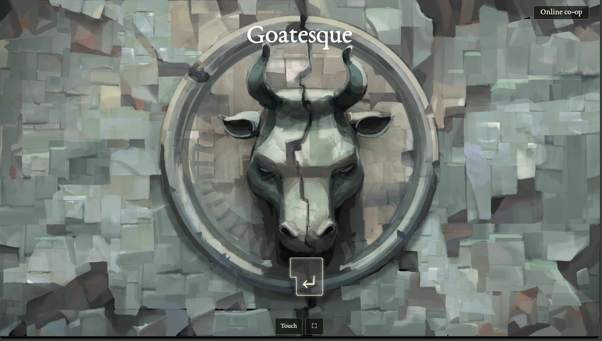
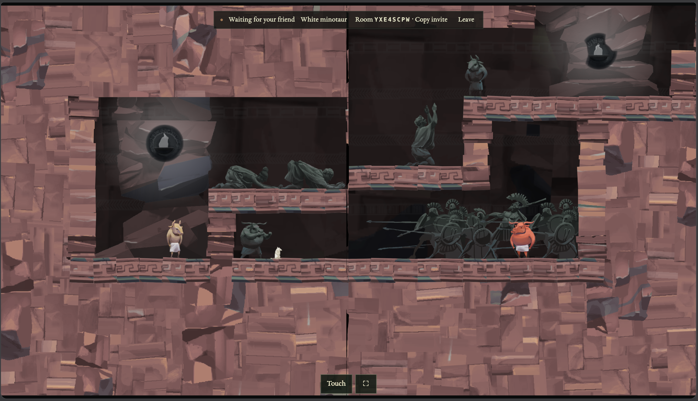
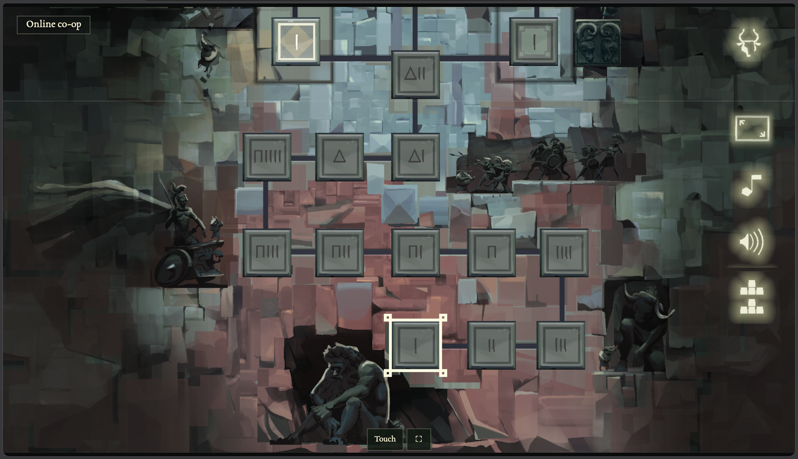
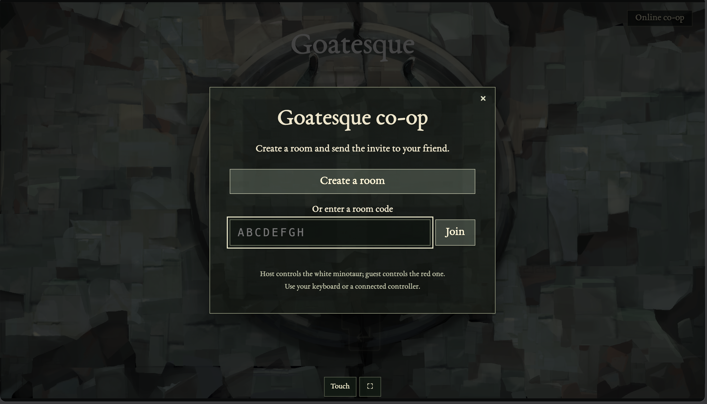
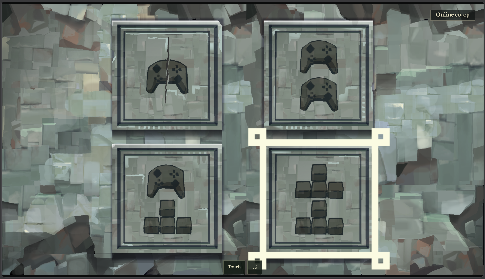
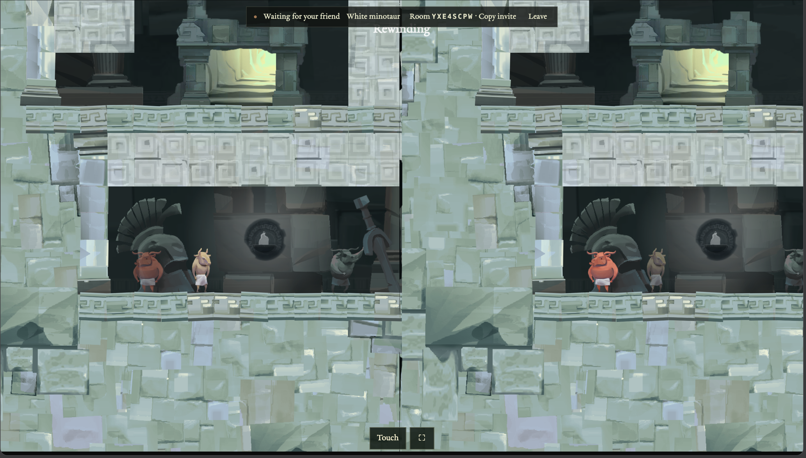
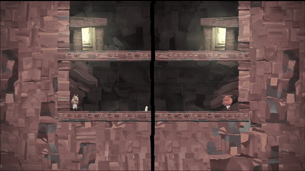
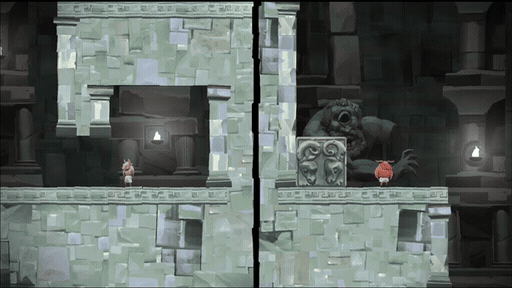

# Goatesque

Goatesque is a playable browser recreation of DYO's cooperative split-screen puzzles, using original artwork, menu and map assets, 31 gameplay rooms behind the original 30 level-map nodes, and room-code online co-op.

[Play Goatesque](https://goatesque.mrinmoy.org) · [Original DYO on itch.io](https://josia-roncancio.itch.io/dyo) · [DYO on Steam](https://store.steampowered.com/app/791470/DYO/) · [How it was rebuilt](#how-it-was-rebuilt)



DYO was created by Josia Roncancio and Team DYO. This independent browser reconstruction adds online room-code co-op and mobile controls; the original game, artwork, music, and design remain credited to their creators.

## Screenshots

These are screenshots of **Goatesque**, using DYO's original artwork.

| Split-screen puzzle room | Campaign map |
| --- | --- |
|  |  |

<details>
<summary>Online lobby, control selection, and rewind</summary>

| Online room creation and joining | Original input-selection screen |
| --- | --- |
|  |  |



</details>

## DYO in motion

These clips show the **original DYO**, from its [official Steam listing](https://store.steampowered.com/app/791470/DYO/). Steam currently supplies the loops as videos; the GIF versions below were converted for this README. They demonstrate the original puzzle mechanics, rather than Goatesque's added online features.

| Split-screen platforming | Coordinating the two views |
| --- | --- |
|  |  |

Promotional footage and original artwork: **Team DYO / Josia Roncancio**. [Media sources and conversion details](docs/media/SOURCES.md).

## How it was rebuilt

The reconstruction started from the official free Windows download on [itch.io](https://josia-roncancio.itch.io/dyo). The game logic was studied statically; the Windows executable was not run here for a matched side-by-side comparison.

1. **Identify the shipped files.** [Reverse Engineer Anything (REA)](https://github.com/morluto/rea), version 6.8.0, inventoried the ZIP and inspected the executable's PE imports. This identified a 32-bit Windows runner. REA rejected the GameMaker `data.win` format, so it was not the tool that recovered the gameplay logic.
2. **Decode GameMaker data and levels.** Small local Python parsers read the `data.win` FORM chunks and VM references, the external `.dlf` grids, and native room declarations. They recovered geometry, spawns, camera sizes, objects, and campaign ordering. The final browser campaign has **31 rooms behind 30 map nodes**.
3. **Verify the mechanics and interface.** [UndertaleModTool CLI](https://github.com/UnderminersTeam/UndertaleModTool), version 0.9.2.0, decompiled selected gameplay and UI entries. Their assignments and control flow supplied the movement constants, seam transforms, rewind rules, gate conditions, menu layouts, and transition timings.
4. **Export and package the artwork.** UndertaleModTool exported the sprites and metadata. Python and Pillow packed **900 frames from 155 sprites into 18 lossless atlases** using [the included packer](scripts/pack-dyo-assets.py). The exported pixels, origins, dimensions, and atlas crops were checked; selected audio was transcoded with FFmpeg, and the original font retains its SIL license.
5. **Implement the browser game.** A newly written [JavaScript engine](public/game/engine.mjs) and [Canvas renderer](public/game/renderer.mjs) consume the recovered numeric layouts and asset manifests. Menus, controls, both screen halves, door/floor effects, and rewind were rebuilt around those observations.
6. **Add browser-specific features.** Touch controls, fullscreen, invitations, and online co-op were added independently. Ludia runs authoritative physics; WebSockets carry inputs and snapshots, with local prediction and adaptive remote interpolation. These online features are additions to DYO's original local co-op design.
7. **Check behavior and regressions.** Node's test runner covers physics, layouts, ownership, replay, gates, rewind, and rendering boundaries. Playwright checks two browser clients, mobile layouts, and delayed/disconnected network scenarios. These checks validate this reconstruction; they do not establish full equivalence to the Windows game.

| Tool | Role in this project |
| --- | --- |
| [Reverse Engineer Anything](https://github.com/morluto/rea) | Archive inventory and PE import inspection |
| Local Python decoders (`struct`, `json`, `hashlib`) | Read GameMaker bytecode references, room data, level grids, and artifact hashes |
| [UndertaleModTool CLI](https://github.com/UnderminersTeam/UndertaleModTool) | Verify focused decompilations and export original sprites/metadata |
| Python + [Pillow](https://python-pillow.github.io/) | Pack and compare lossless sprite atlases |
| [FFmpeg](https://ffmpeg.org/) | Transcode selected audio and prepare the Steam-loop GIFs above |
| Node.js + Canvas + Playwright | Implement and validate the browser reconstruction and online transport |

See [REVERSE_ENGINEERING.md](REVERSE_ENGINEERING.md) for the artifact digest, workflow, generated-data map, and fidelity limits. Original executables, recovered disassemblies, and research-only exports stay outside this repository.

## Ludia hosting

**Goatesque** is live at `https://goatesque.mrinmoy.org`. The original source artwork and Team DYO credit remain attributed to their creators.

Build the standalone deployment on your Mac:

```sh
node scripts/build-standalone.mjs
node --max-old-space-size=40 outputs/goatesque/server.mjs --public outputs/goatesque/public --port 8792
```

The standalone build uses the same page, styles, engine and assets as the framework build. Ludia runs the Node 16+ authoritative simulation (with a pinned, bundled MIT-licensed WebSocket library), with nginx serving static files and proxying `/api/rooms` and `/api/health`. Up to four rooms live in memory and disappear on service restart. No database is needed there. The user service has `MemoryHigh=80M`, `MemoryMax=96M`, no swap allocation, and `CPUQuota=25%` (one quarter of a CPU).

See [deploy/ludia/README.md](deploy/ludia/README.md) for DNS, activation and service commands. Build output is under ignored `outputs/goatesque/`; original research and recovered executable/source are excluded.

## Framework development and existing Sites copy

```sh
npm ci
npm run dev -- --port 5173
```

Local multiplayer works immediately. Use the standalone Node server above for current online co-op. The older Sites copy and its D1 relay are retained for reference and do not support protocol 3. Its previous database setup was:

```sh
npm run build
node --import ./scripts/sites-env.mjs ./node_modules/wrangler/bin/wrangler.js d1 execute DB --local --config dist/server/wrangler.json --persist-to .wrangler/state --file drizzle/0000_redundant_lake.sql
```

Apply that migration once per local database. Hosted migrations are applied during deployment.

## Play

- Player 1: A/D move, W jump, S lock camera, F enter/leave a door.
- Player 2: arrows move/jump/lock, Enter enters/leaves a door.
- Hold Q (white) or Shift (red) to rewind both characters. Hold E and Ctrl together to exchange screens when both players are grounded. These abilities unlock at their original campaign points.
- Both panes are visible on both devices in every room, including the introductions. Collapsing floors animate falling stone and dust; exits finish closing before the completion transition. These animation states restore when rewinding.
- Space swaps the two keyboard movement/action sets in local play; F and Enter remain the respective doorway controls. Escape returns to the level map with the original stone-head transition.
- Arrows navigate menus; Space/Enter confirms. New saves begin with the original four input choices. Standard browser gamepads support shared controller, two controllers, or controller plus keyboard. Touch controls include a character selector.
- The Touch toggle enables thumb controls for movement, jump, lock, doorway, held rewind and screen exchange. Online controls always operate your own character; local play has a White/Red selector. Local touch screen exchange operates both switch controls together. The full-screen button is always available. Browsers without element fullscreen can launch the game from a Home Screen shortcut; portrait and landscape layouts respect safe areas.
- Completion closes the stone heads and waits for Space/Enter/Up, then returns to the map. R restarts while this completion screen is waiting. The first introduction advances automatically to the second.
- Online: choose Online co-op → Create a room → copy invite. Your friend opens the link and joins. Either movement key set controls your own character. The room creator chooses levels; Ludia simulates both players. Menus and transitions synchronize between browsers. Either player can confirm completion or return to the map.

Ludia owns both players, shared physics, time, gates and world events at 60 Hz. Both browsers predict only their own character, then restore server snapshots and replay every unacknowledged input command. Player command streams, action counters and acknowledgments remain separate. If an input frame has not arrived, that player's body and camera wait; the server never inserts unacknowledged gravity or friction steps. After a jitter spike, the server drains up to four body commands per player per tick until the queue is small again. Shared animation effects still advance once per server tick; shared-action changes remain ordered. The room creator retains control of menus and level selection.

WebSockets are the primary transport: 60 Hz input delivery and 30 Hz state updates share one persistent authenticated connection. Reliable WebSocket input messages contain newly generated commands; reconnects resend the pending history, which remains available for reconciliation. If the proxy cannot upgrade WebSockets, a persistent server-sent event stream delivers state at 30 Hz while compact POSTs carry inputs. Ordinary HTTP polling remains a final fallback. Tokens are sent in message/request bodies, never URL parameters. Messages and buffered writes are bounded; snapshots coalesce for slow connections. No extra public application port is opened.

A four-frame input buffer (at most 80 ms to prime) absorbs short gaps. The other player's body and camera use a 50–140 ms display buffer that adapts to arrival jitter, bounded cubic interpolation, and at most 60 ms extrapolation. Fractional-frame local prediction smooths rendering above the 60 Hz physics rate without changing simulation state or crossing collision/portal boundaries early. Local movement remains predicted immediately. Teleports, gates, rewind and level changes reset interpolation. Input acknowledgement progress is monitored separately from state delivery, so a stalled uplink cannot keep replaying abandoned movement while the downlink remains alive.

The public WebSocket route is enabled on Ludia and has passed two-browser HTTPS verification. For a fresh installation, the one-time root-owned route update is prepared in `deploy/ludia/enable-websocket.py`:

```sh
ssh -t ludia 'sudo python3 /home/mrinmoy/goatesque/current/enable-websocket.py'
```

The script changes only Goatesque's virtual host, preserves TLS settings, backs up the previous file, checks nginx, reloads it, and restores the original on failure. Both browsers should refresh and create a new room after updating. Tailscale is optional and is not configured.

## Verification

```sh
node --test tests/*.test.mjs
npx tsc --noEmit
npm run build
```

The tests cover all 31 room spawns, movement, jump trajectory, portal clipping, unequal-view scaling, gates, suspended blocks, held rewind, cooperative screen switching, tutorial unlocks, shared intro cameras, the playable ending, map prerequisites, transition timings, and synthetic gamepad input. Two-browser checks additionally exercised menu flow, keyboard swapping, room creation/join, remote movement, locking, level changes, completion confirmation, map return, third-player rejection, and token checks. Physical gamepads have not been tested.

Read [REVERSE_ENGINEERING.md](REVERSE_ENGINEERING.md) for provenance and fidelity limits. This is an independent reconstruction, not an official DYO release. Original artwork, interface, music and sound effects are credited to Team DYO. The original executable and recovered source code are not served by this site.

## Original artwork

`public/game/assets/manifest.json` describes 900 original PNG sprite frames from 155 sprites, packed losslessly into 18 atlases. This includes the original title and completion heads, input-selection tiles, scrolling level map, number glyphs, control panels, and playable credits artwork. The original input background is included separately. Sprite origins, all five themes, native scenery placement, character animation timing, and architectural edge selection come from the analyzed release. Every packed frame was compared pixel for pixel against the exported PNG. The original EBGaramond font is accompanied by its SIL license. Selected original sound effects and title/map music are AAC transcodes of the recovered audio.

To regenerate the atlases from UndertaleModTool sprite exports (Pillow required):

```sh
python scripts/pack-dyo-assets.py /path/to/export /path/to/output --include-ui
```

The export directory must contain `metadata.json` with sprite dimensions/origins and a `Sprites/` folder of numbered PNG frames. Pack into a research directory, then copy the content-addressed atlases and manifest into `public/game/assets/`. `render-map.json` records the recovered visual mappings. Original artwork remains Team DYO's work; this reconstruction does not provide a new license to those assets.
